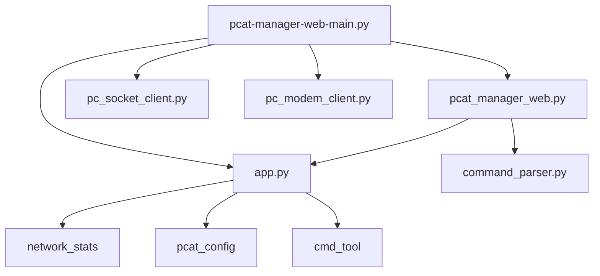

## 主要文件结构和关系

1. `pcat-manager-web-main.py` - 主入口文件
- 导入并初始化主要组件
- 处理命令行参数
- 启动三个主要线程:
  - FlaskAppThread (Web服务)
  - PcSocketClient (Socket客户端)
  - PcModemClient (Modem客户端)
  - App (主应用线程)

2. `pcat_manager_web.py` - Web服务器实现
- 基于Flask实现的Web服务器
- 处理所有HTTP/WebSocket请求
- 提供Web界面和API接口
- 依赖:
  - Flask
  - SocketIO
  - app.py中的功能
  - command_parser.py中的解析功能

3. `app.py` - 核心应用逻辑
- 包含App类作为主应用线程
- 提供系统状态监控
- 处理网络统计
- 管理设备配置
- 提供各种辅助函数
- 依赖:
  - network_stats模块
  - pcat_config模块
  - cmd_tool模块

4. `pcat_util/command_parser.py` - 命令解析工具
- 提供各种命令行输出解析功能
- 主要用于解析无线网络配置
- 提供WiFi接口状态检查
- 独立性较强,主要被Web服务器调用

## 模块间的主要依赖关系

## 主要功能职责

1. Web服务相关:
- `pcat_manager_web.py` 处理所有Web请求
- 提供REST API和WebSocket接口
- 处理用户认证和会话管理

2. 系统管理相关:
- `app.py` 负责系统监控和配置
- 处理网络接口管理
- 收集系统状态信息

3. 命令解析相关:
- `command_parser.py` 专注于命令输出解析
- 主要处理无线网络配置相关的命令

4. 设备通信相关:
- `pc_socket_client.py` 处理Socket通信
- `pc_modem_client.py` 处理Modem通信

## WEB 页面功能

- 登录页面 app/templates/login.html
- 主页面 app/templates/index.html
- 设备控制页面 app/templates/device_control.html

### WiFi 设置

页面模板：app/templates/settings.html
获取配置信息接口：GET /api/v2/wireless.json
保存配置信息接口：POST /api/v1/wireless.json

### 开关机策略
- 开关机策略页面 app/templates/timer.html

### Modem
- Modem 页面 app/templates/modem.html

### 数据统计
- 数据统计页面 app/templates/statistics.html
- 更新页面 app/templates/update.html